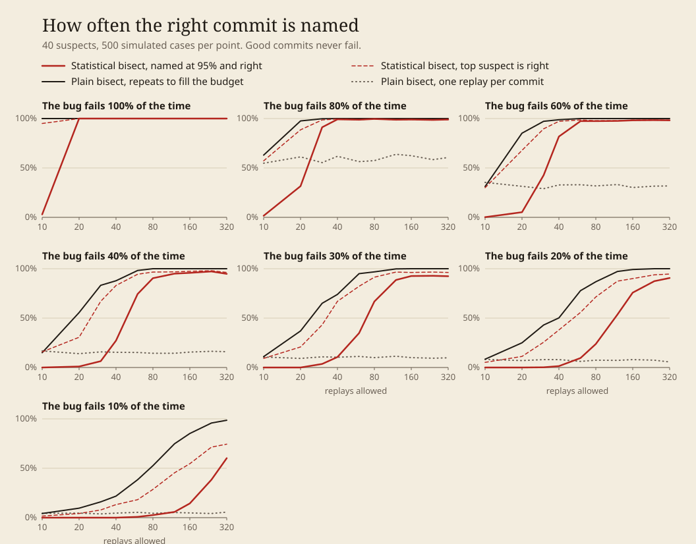
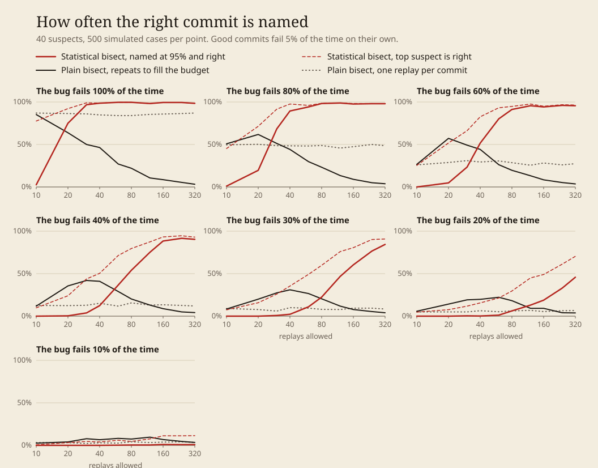

# Simulator results

How often does the lineup name the right commit, for a given number of replays? This folder answers that with simulated cases, where the culprit is known.

Each case has 40 suspect commits and one culprit picked at random. Every point is 500 cases. Three methods get the same cases and the same replay budget:

- The statistical bisect in `whodunit/lineup.py`. It names a commit only when it is 95% sure, and otherwise hands back the suspects that remain with their probabilities.
- Plain bisect with repeats. It replays each commit as many times as the budget allows and calls the commit bad on the first failure.
- Plain bisect with one replay per commit, which is what `git bisect run` does.

To regenerate everything here, run `uv run python -m whodunit.simulate --out eval/simulator`. It takes about two minutes. `tables.md` has every number behind the charts, and `results.json` has the raw counts.

## When good commits never fail

Plain bisect with repeats wins here at every budget. For a bug that fails 30% of the time, 80 replays get it to 97% while the statistical bisect names the right commit in 67% of cases. The statistical bisect needs 160 replays to reach 93%.

The reason is that plain bisect with repeats assumes a single failure convicts a commit, and in this world that is true. The statistical bisect does not assume it. It starts out believing a good commit fails about 5% of the time and spends replays finding out.

Two things are worth knowing before picking plain bisect on that basis. Its mistakes are silent: with 40 replays on the 30% bug it names the wrong commit in 26% of cases and gives no sign of it, where the statistical bisect names the wrong one in 2% and says "not sure yet" in the rest. And the dashed line shows the statistical bisect's top suspect is right in 91% of cases at 80 replays, so most of its "not sure yet" answers are pointing at the culprit already.

Plain bisect with one replay per commit is right 10% of the time on the 30% bug, at any budget.

## When good commits fail 5% of the time on their own

Agents are rarely this clean. Give every good commit a 5% chance of failing by itself and plain bisect with repeats falls apart, and more replays make it worse. On the 30% bug it is right in 31% of cases with 40 replays and 4% with 320, because every extra replay of an innocent commit is another chance for a stray failure to convict it. Even a bug that fails every time is found in only 46% of cases at 40 replays.

The statistical bisect holds up. On the 30% bug it names the right commit in 60% of cases with 160 replays and 84% with 320. On a bug that fails every time it is right in 99% of cases and uses about 21 replays.

## Where it falls short

- A bug that fails 20% of the time on a flaky baseline is named in only 46% of cases, even with 320 replays. The top suspect is right in 70%.
- The 95% bar is not always met. Across the cells, the share of cases with a wrong accusation runs from 0% to 7%, and the 7% is the 30% bug on a flaky baseline at 320 replays. The model assumes one change point and two fixed failure rates, and the prior on the good rate is a guess.
- These are simulated commits with independent replays. Real replays share a model provider and a machine, so their failures can come in bursts, which this does not capture.
- Small budgets are spent mostly on warming up. Below about 30 replays the statistical bisect rarely names anyone unless the bug fails every time.

## What changed from the first design

Two things, both found by simulating the 30% bug across 40 suspects with 300 replays allowed.

The first version put a uniform prior on both failure rates, so it had to learn from scratch that good commits mostly pass. It solved 59% of cases. Starting from the belief that a good commit fails about 5% of the time, loosely held, took that to 93%.

The brief said to test the commit that splits the posterior mass most evenly. The code now defaults to the replay with the highest expected information gain, and keeps the even split as `how="split"`. With the uniform prior the difference was large, 92% against 59%. With the current prior it is small: 282 cases solved against 280 out of 300, using 79 replays on average against 83. So the prior did the work, and the choice of picker barely matters.
